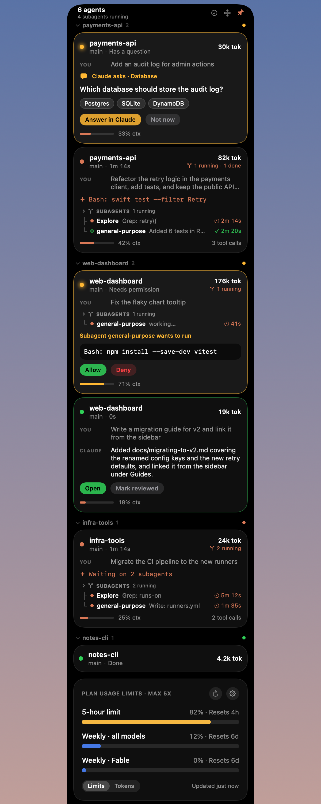
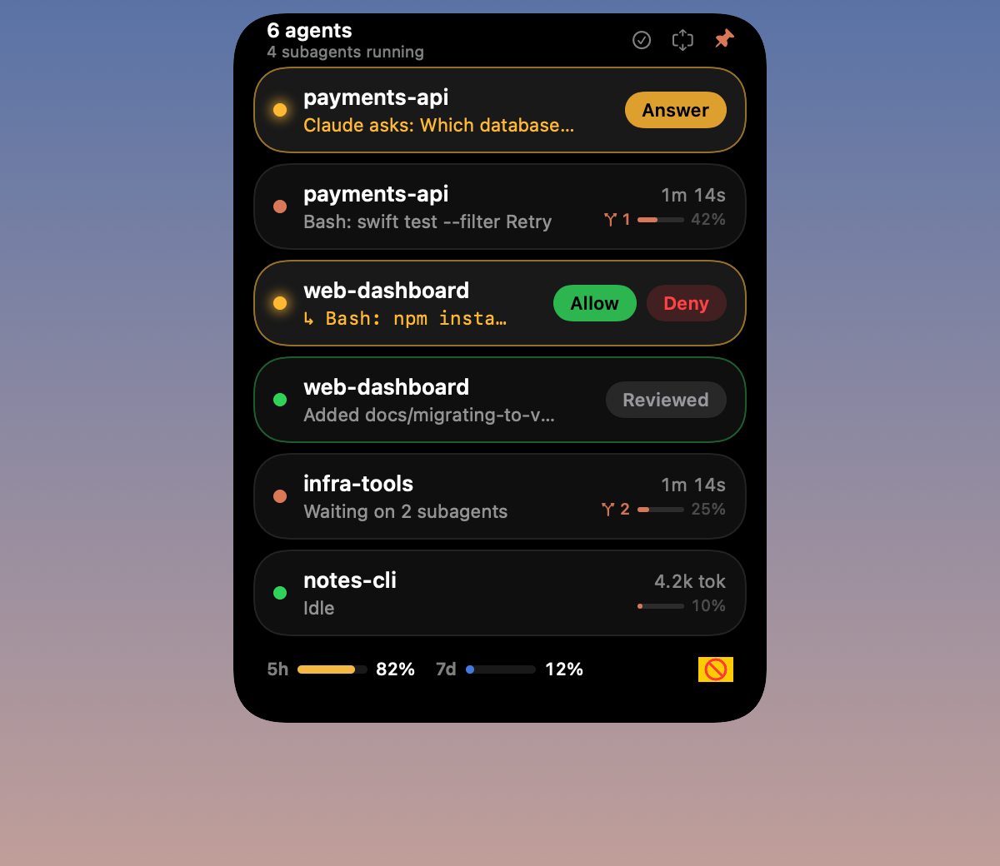

# Claude Notch

**A Dynamic-Island-style companion for [Claude Code](https://claude.com/claude-code) on MacBooks with a display cutout.**
See every running agent at a glance, get told when something finishes or needs you, approve tool permissions
without switching windows, and keep an eye on your plan limits. All of it lives around the notch.

<p align="center">
  
</p>

<p align="center">
  
  &nbsp;&nbsp;
  
</p>

## Features

- **Always-visible status.** The collapsed island shows a Claude tile (coral = working, amber = needs you, green = done,
  with a count badge) and a live waveform that moves while an agent works.
- **Two expanded views, and it remembers your choice.** Hover (or click) to open the **Detailed** view, grouped into **Needs you**, **Ready to review**, **Working** and **Idle**, or the **Compact** view: one line per session with Allow/Deny inline and a mini plan-limit readout. Flip between them from the island header; the last one you used is restored every time, even after a relaunch. Clicking a session in the compact view jumps to it in the detailed view (until the island closes, so your saved choice is untouched).
- **Narrow by design.** The island is 320 pt (compact) to 350 pt (detailed) wide by default, in the proportions of the system media island; widths are adjustable in Settings.
- **Grouped by project, like the desktop sidebar.** Sessions sit under collapsible project headers (worktrees join their repository) with a state dot, a session count and open-PR count; a collapsed header still says "2 need you". Sessions started from another session are indented under it. Project folders come from hooks; PR counts and parent links are read, read-only and best effort, from the desktop app's local session metadata, and simply absent if that format changes. Cloud sessions run remotely and never reach the island. Turn off in *Settings ▸ General* to group by state instead.
- **Everything about a session.** Name, branch, elapsed time, the **prompt** that started the turn, the current tool,
  the **subagent tree** (what each is doing and how long it took), context usage, lines changed, and, when a turn
  finishes, **Claude's result** for you to review.
- **A subagent tree you can explore.** The header counts the total ("6 agents" over "4 subagents running"), and every session shows its own stat under its token count ("⑂ 2 running · 1 done"; a branch glyph and count in the compact view). Each session lists its subagents running-first with a ├/└ tree; tap the **Subagents** header to open all of them with what each is doing right now, its tool-call count and its last result. A session whose main turn has ended but whose subagents still run stays **Working** ("Waiting on 2 subagents") and is only marked finished, with its notification, when the last one stops. A subagent silent for 15 minutes is treated as finished so nothing can stay stuck.
- **Questions look like questions.** When Claude asks you something, the island shows the question and its choices with **Answer in Claude** / **Not now** (a single **Answer** button in the compact view) instead of a raw tool name with Allow/Deny.
- **Reviewed without busywork.** A finished result moves out of *Ready to review* by itself when you reply in that session, or when you view the full result in the island (pointer over the detailed view) for about five seconds. The island opening on its own for a notification never counts, and neither does the truncated compact view. Claude Code has no "the user read this" signal, so these are the honest signals available; *Settings ▸ General* switches to fully manual, and **Open** / **Mark reviewed** always work.
- **Approve from the island.** Tool-permission requests show the exact command with **Allow / Deny**. Requests from a
  subagent say so.
- **Plan limits like Claude Desktop.** 5-hour, weekly, and per-model weekly limits as percentage bars with reset times
  (blue, amber from 75%, red from 90%). A **Limits | Tokens** toggle on the card flips to token totals for the last
  5 hours, today, and 7 days; percentages are the default. On Pro/Max dollars are hidden (you are metered by quota, not money);
  on API billing the cost is shown.
- **Notifications** (sound and system banners) for approval needed, waiting for input, finished, and failed, each toggleable.
- **Click anywhere on a session** to jump to the app it runs in. A single [settings window](#settings) controls the rest.
- **Private and local.** No network code. See [SECURITY.md](SECURITY.md).

## Requirements

- A Mac running **macOS 14 or later**. Designed for notched MacBook Pros; works on other displays with a virtual island.
- **Claude Code** (CLI and/or the Claude desktop app's Code tab).
- To build: the Swift 6 toolchain (Xcode or just the Command Line Tools).

## Install

There are no binary releases yet; build from source:

```bash
git clone https://github.com/jdalessandro/claude-notch.git
cd claude-notch
make bundle                 # builds dist/ClaudeNotch.app (menu-bar-only, ad-hoc signed)
open dist/ClaudeNotch.app
```

Then click the island ▸ **Install hooks** (or *Settings ▸ Integration*), and restart any Claude sessions that were
already running. Hooks are merged into `~/.claude/settings.json` alongside any you already have, with a one-time backup
at `settings.json.claude-notch.bak`. To remove everything later: *Settings ▸ Integration ▸ Uninstall*.

Because the build is ad-hoc signed, macOS may ask you to confirm the first launch (right-click ▸ Open).

**Just want to look around?** `make demo` launches the app with synthetic agents and no setup.

## How it works

```
claude (CLI / desktop) ── hook event ──▶ claude-notch-hook ── Unix socket ──▶ ClaudeNotch.app ──▶ the island
                                                              ◀── Allow / Deny (permission requests only)
claude status line ─────────────────────▶ claude-notch-hook --statusline ──▶ quota windows
~/.claude/projects/**/*.jsonl ──────────────────────────────────────────▶ tokens, context, usage windows
```

| Source | What it provides |
|---|---|
| **Claude Code hooks** | Live events: prompts, tool calls, subagent start/stop, permission requests, notifications, turn end. |
| **Transcripts** | Token usage, model, titles, context size, Claude Code's own cost figure. Also the basis for 5-hour/today/7-day totals. |
| **Status line** (opt-in) | The only place real **quota percentages** and exact context-window size are exposed. |

The Agent SDK is deliberately not used: it launches and controls sessions of its own and cannot attach to a running
one. Details and what was verified are in [docs/RESEARCH.md](docs/RESEARCH.md) and [docs/ARCHITECTURE.md](docs/ARCHITECTURE.md).

### Claude desktop app

Sessions from the desktop app's Code tab fire the same hooks and write the same transcripts, so they appear alongside
CLI sessions. They don't report which terminal they run in, so clicking one opens the Claude app.

## Quota gauges (Pro / Max)

Percentages for the 5-hour and weekly limits come from Claude Code's status line. Turn them on with
*Settings ▸ Integration ▸ Enable quota gauges* (or the **Enable** button in the Usage card). This registers
`claude-notch-hook --statusline` as your status line **only if you don't already have one**; an existing status line is never replaced.
The last report is saved (`quota.json` in Application Support) and shown with an "Updated … ago" pill, so the bars stay populated between terminal sessions and across app restarts. Until a terminal session has reported at least once, the card says so (use the **Tokens** toggle meanwhile).

> **Terminal sessions only.** The status line is a terminal feature, so limits arrive when a Claude Code *terminal*
> session responds. Sessions that run only in the Claude desktop app's Code tab may never report them; if you never see
> percentages, that is the likely reason, and the token totals still work. Window resets are handled locally: a window
> whose reset time has passed shows as 0%, not a frozen number.

## Approving permissions from the island

With *Approve permissions from the island* on (default), the `PermissionRequest` hook holds Claude's prompt until you
click **Allow** or **Deny**. Things to know:

- Claude waits (up to Claude Code's 10-minute hook timeout), and the terminal prompt does not appear while it waits.
- If the app isn't running, the hook exits immediately and the normal terminal prompt appears: it never blocks a session.
- Prefer to answer in the terminal? Turn the setting off for **observe-only** mode; you still get notified.

## Settings

Open from the island's **⋯ ▸ Settings…**, the menu-bar icon, or ⌘, while the app is active. Changes apply immediately.

| Tab | Options |
|---|---|
| **General** | Group by project · island style (floating / attached), width, collapsed view (tile + waveform / waveform only), hide when idle · expanded view (compact / detailed), expand on hover, hover delay, auto-open on events and how long, forget idle sessions after |
| **Content** | Show prompt, subagents, context meter and changed lines, usage and quota · usage card shows limits (%) or tokens · dollar cost (automatic / always / never) |
| **Notifications** | Per event (approval, input, finished, failed) · sound · system notifications · include command/reply details in banners |
| **Integration** | Install / reinstall / uninstall hooks · approve from the island · quota gauges |
| **Advanced** | Raw event log (diagnostics) · reset to defaults · version |

## Troubleshooting

| Symptom | Try |
|---|---|
| Nothing appears | Is the app running (menu-bar sparkle)? Are hooks installed (*Settings ▸ Integration*)? Restart Claude sessions started before installing. |
| Subagents show up late, or the footer says **Update hooks** | Your hooks were installed by an older version and miss events (such as `SubagentStart`). Click **Update hooks** (or *Settings ▸ Integration ▸ Reinstall*). |
| Island flickers or won't open | Increase *Hover delay*, or turn off *Expand on hover* and click to open. |
| No quota percentages | Enable quota gauges, then run `claude` in a **terminal** and send one message; the report is remembered afterwards. Limits only exist for Pro/Max, and the desktop app's Code tab doesn't send them. If you already use a custom status line, Claude Notch leaves it alone. |
| Dollars shown/hidden unexpectedly | *Settings ▸ Content ▸ Dollar cost*. |
| Want to see raw events | *Settings ▸ Advanced ▸ Log raw hook events* (the log contains prompts: keep it private). |

## Development

```bash
make build test      # build and run the 127-test suite
make lint            # swift-format, strict
make format          # fix formatting
make demo            # run with fake agents
make snapshots       # re-render docs/screens/*.png (offscreen)
```

See [CONTRIBUTING.md](CONTRIBUTING.md). With only the Command Line Tools installed, the compiler occasionally reports
`plugin for module 'TestingMacros' not found`; re-run. Source layout:

```
Sources/ClaudeNotchCore   pure logic: events, state machine, transcript + usage parsing, IPC, installer, preferences
Sources/claude-notch-hook the forwarder Claude Code invokes (never blocks a session)
Sources/ClaudeNotch       the app: AppKit panel, SwiftUI views, settings window
Tests/                    Swift Testing suites
```

## Reliability

The hook forwarder runs inside your Claude sessions, so it is built never to get in the way: every socket operation has
a deadline (about a second), prompts and tool inputs are truncated before sending, and if the app is not running it
exits silently. The app reads each connection under a short total deadline and delivers events strictly in order, so one
stalled client cannot delay or reorder the rest. Config changes are guarded: the installer follows symlinks, preserves
file permissions, refuses to touch unexpected JSON shapes, skips no-op writes, and aborts if another tool modified
`settings.json` while it worked.

## Limitations

- Plan-limit percentages need a terminal Claude Code session to report them (see above); desktop-only use shows the last remembered values.
- The status line reports the 5-hour and weekly windows; per-model weekly rows (like Claude Desktop's "Weekly · Fable") appear only if Claude Code includes them.
- Context-window size is inferred (200k, or 1M if observed larger) unless the status line is enabled.
- The `Notification` payload field names come from documentation excerpts; the state machine also falls back to the message text.
- Clicking a session activates the terminal/app but cannot focus a specific tab.
- Island geometry is derived from the screen's safe-area values; the floating style's top gap is calibrated to current hardware.

## Roadmap

Launch or resume agents from the island (Agent SDK) · send a quick follow-up prompt · spend-limit row for API plans ·
signed and notarized releases · launch at login.

## License

[MIT](LICENSE)
