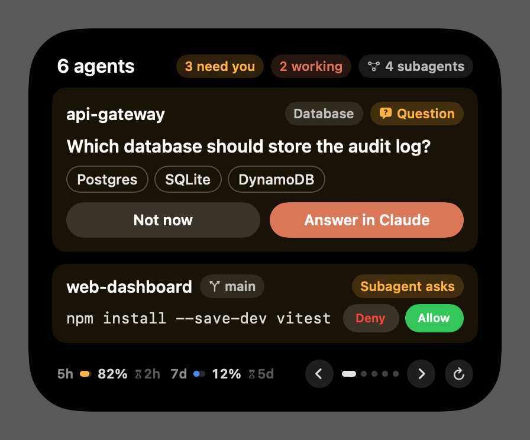
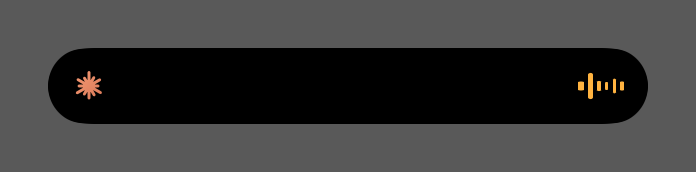
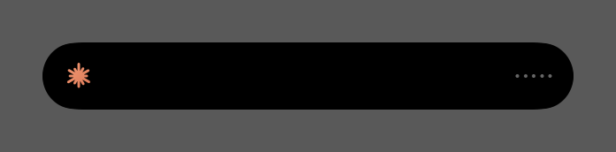
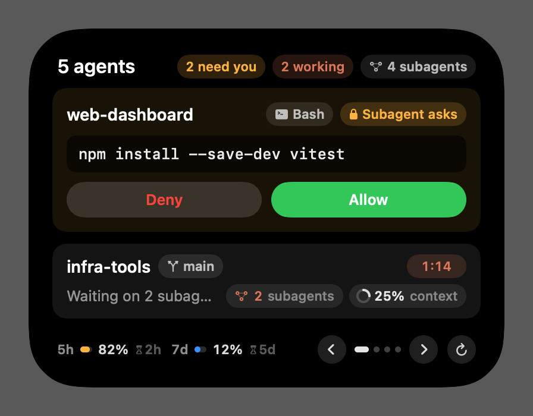
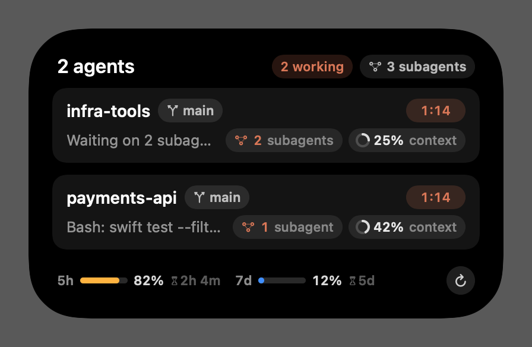
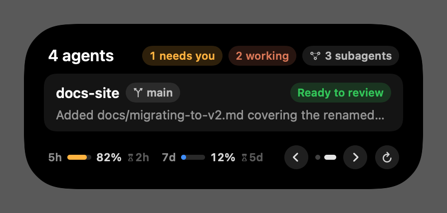

# Claude Notch

**Your [Claude Code](https://claude.com/claude-code) sessions as a Live Activity in the Mac's Dynamic Island.**
An independent project, not affiliated with or endorsed by Anthropic ([details](#trademarks-and-affiliation)).
See every running agent at a glance, answer permission requests and questions without switching windows, and keep an
eye on your plan limits. All of it lives around the notch.

<p align="center">
  
</p>

## The island

Claude Notch is a macOS **Live Activity** (ActivityKit, macOS 27.3+). The system draws it in the island beside the
camera cutout, decides its size and position, and expands it; the app feeds it state as your sessions change.

### Compact

The logo sits on the left of the cutout and a waveform on the right: one bar per working session, thinner bars for
their subagents. A Live Activity can't run animations on its own, so the app sends a beat about once a second while
agents run and the bars move to it. The waveform is coral while agents work, amber when something waits on you, and
rests as dots when nothing runs.

<p align="center">
  
  &nbsp;
  
  &nbsp;
  
</p>
<p align="center"><sub>Working · needs you · idle</sub></p>

### Expanded

- **A header up beside the cutout**, like Apple Music: the agent count on the left, and badges on the right for how
  many sessions **need you**, how many are **working**, and how many **subagents** are running. When room runs short,
  the least urgent badges drop out.
- **The most urgent request as a featured card.** A permission request shows the tool and the exact command with
  **Allow** / **Deny** (and says *Subagent asks* when a subagent wants it). A question from Claude shows its text and
  its answer options, with **Answer in Claude** (opens the session so you can pick) and **Not now**. If the hook isn't
  waiting for an answer, the card offers **Open** instead.
- **Session cards** below it, each with the project name, its git branch and its status. A working session shows a
  live timer, what it is doing right now, and its stats: running subagents (or how many finished), lines added and
  removed, and how full its context window is (the ring turns amber past 65% and red past 85%). A second permission
  request gets **Deny** / **Allow** right on its card; other sessions that wait on you get **Answer** or **Open**; a
  finished turn shows the start of Claude's reply and **Ready to review**.
- **Tap a card to jump to its session.** For sessions in the Claude desktop app's Code tab, **Open** deep-links
  straight to that conversation in Claude Desktop. CLI sessions bring forward the terminal they run in (iTerm,
  Terminal, Ghostty, WezTerm, VS Code, Warp).
- **A one-line footer with your plan limits** (Pro / Max): the 5-hour and weekly limits as small bars with their
  percentages (blue, amber from 75%, red from 90%), each followed by an hourglass and the time until it resets, in the
  style of Claude Desktop (the 5-hour limit in hours and minutes, rounded to hours when the line is tight; the weekly
  one in days). The **refresh** button at
  the end of the line asks Anthropic for fresh numbers right away.

<p align="center">
  
</p>
<p align="center"><sub>A subagent's permission request, answered from the island.</sub></p>

<p align="center">
  
</p>
<p align="center"><sub>Working sessions: branch, live timer, current activity, subagents and context.</sub></p>

### Paging

A Live Activity can't scroll, so sessions come in pages: up to three cards per page (one beside a featured request,
two at the larger island sizes). The **‹ ● ○ ›** pager in the footer turns them, and the island turns them by itself
every few seconds while you aren't tapping it. A tap holds the current page for a while, and anything new that needs
you jumps back to the first page.

<p align="center">
  
</p>
<p align="center"><sub>Page two: a finished turn, ready to review.</sub></p>

### When something needs you

A permission request, a question, a session waiting for input or a failed turn raises the island on its own, with a
chime if sound is on. Finished results raise it too unless you turn that off (see [Settings](#settings)). Answering
from the island resolves exactly the request you saw: a tap on a request that has since been answered or replaced is
ignored.

### All quiet

With no sessions running, the expanded island shows your plan limits in full, with when each resets.

<p align="center">
  
</p>

### Island size

Five steps from *Smaller* to *Larger* scale the island's text and icons. The two largest sizes fit two session cards
per page instead of three.

<p align="center">
  
</p>
<p align="center"><sub>The Larger size: two cards per page.</sub></p>

> The screenshots are rendered offscreen from the app's demo data (`make snapshots`). On a real Mac the system draws
> the island's shape and places the header beside the cutout, so the frame differs slightly.

## Requirements

- A Mac running **macOS 27.3 or later** (Live Activities on the Mac). Best on a MacBook with a notch.
- **Claude Code** (the CLI and/or the Claude desktop app's Code tab).
- To build: **Xcode 27.3+** and an Apple developer team for signing. A free Personal Team is enough for local builds,
  but ad-hoc signing isn't: the island's buttons are App Intents, which the system only runs for properly signed apps.

## Install

There are no binary releases yet; build from source:

```bash
git clone https://github.com/jdalessandro/claude-notch.git
cd claude-notch
echo YOUR_TEAM_ID > .xcode-team   # 10 characters, from Xcode ▸ Settings ▸ Accounts (never committed)
make bundle                       # generates the Xcode project and builds dist/ClaudeNotch.app
open dist/ClaudeNotch.app
```

The app comes to the foreground for a moment (starting a Live Activity requires it), starts the island, then lives in
the menu bar (✦). If the island ever goes missing, choose **Show Island** from that menu.

### Connect Claude Code (install the hooks)

Open **Settings ▸ Integration** and click **Install hooks**, then restart any Claude sessions that were already
running. The hooks are merged into `~/.claude/settings.json` alongside any you already have, with a one-time backup at
`settings.json.claude-notch.bak`. They call a copy of the forwarder in `~/Library/Application Support/ClaudeNotch/bin`,
which the app refreshes on launch after an update.

**Updating hooks:** when your hooks were installed by an older version and miss events the island needs (such as
`SubagentStart`), the Integration tab says an update is available. Click **Reinstall**. To remove everything:
**Settings ▸ Integration ▸ Uninstall**.

**Just want to look around?** `make demo` launches the app with synthetic agents and no hooks.

Signed and notarized releases with a Homebrew cask are being set up (`scripts/release.sh`,
`packaging/claude-notch.rb.template`); until the first release is published, build from source as above.

## Settings

Open **Settings…** from the menu-bar icon, or press ⌘, while the app is active. Changes apply immediately and persist;
**Advanced ▸ Reset all settings…** restores the defaults below.

### General

| Setting | Default | What it does |
|---|---|---|
| **Island size** | Default | A five-step slider: *Smaller*, *Small*, *Default*, *Large*, *Larger*. Scales the island's text and icons (88% to 125%). *Large* and *Larger* show two session cards per page instead of three. |
| **Raise the island when something needs you** | On | Also raises the island when a turn finishes with a result to review. Permission requests, questions, sessions waiting for input and failed turns always raise it. |
| **Forget idle sessions after** | 12 hours | 1 hour, 4 hours, 12 hours or 1 day. An idle session drops off the island after this long. |

### Content

| Setting | Default | What it does |
|---|---|---|
| **Show on each session**: your prompt, subagents, context meter and changed lines, usage and quota | All on | These toggles don't change the island, which always shows names, branch, status, requests, subagent and context stats and the plan-limit footer. |
| **Usage card shows** | Plan limits (%) | Percentages or token counts for the usage card. The island's footer always shows percentages. |
| **Dollar cost** | Automatic | *Automatic* hides dollars on Pro and Max (you're metered by quota, not money) and shows them on API billing; *Always* / *Never* override it. The island never shows dollars. |
| **Detected plan** | | Read-only: the plan Claude Notch detected from Claude Code's login (`~/.claude.json`) and environment. |

### Notifications

| Setting | Default | What it does |
|---|---|---|
| **Notify me when**: approval needed, waiting for your input, turn finished, turn failed | All on | Which events send an alert. |
| **Play a sound** | On | A chime with the alert. While the island is live, the island's own alert carries the sound. |
| **Show system notifications** | On | Banners in Notification Center. |
| **Include details in banners** | On | Puts the command or a snippet of Claude's reply in the banner. Turn off if banners can show on a locked screen you share. |

### Integration

| Setting | Default | What it does |
|---|---|---|
| **Claude Code hooks** | Not installed | **Install hooks**, **Reinstall** (also applies updates) and **Uninstall**; see [Install](#connect-claude-code-install-the-hooks). |
| **Approve permissions from the island** | On | The `PermissionRequest` hook waits for your **Allow** / **Deny** on the island. Off is observe-only: the normal terminal prompt appears and you're still notified. Changing it rewrites the hook entry automatically. |
| **Quota gauges** | Off | Registers `claude-notch-hook --statusline` as Claude Code's status line, which also reports the exact context-window size and plan limits while a terminal session answers. Only installed if you don't already have a status line; an existing one is never replaced. Optional: the plan limits come from the usage API either way. |

### Advanced

| Setting | Default | What it does |
|---|---|---|
| **Log raw hook events** | Off | Writes every hook event to `~/Library/Application Support/ClaudeNotch/events.jsonl` for debugging. It contains prompt text and tool inputs: keep it private. **Show log in Finder** reveals it. |
| **Reset all settings…** | | Restores every default above (hooks and the status line are left as they are). |

## Plan limits

On Pro and Max, the footer's numbers come from the same request Claude Code's `/usage` makes
(`api.anthropic.com/api/oauth/usage`), authenticated with **Claude Code's own login** from your keychain. macOS asks
once to allow access to the `Claude Code-credentials` item. The app asks about every five minutes and whenever you tap
**refresh** on the island; the last numbers are saved, so they survive restarts. If a request fails, the island keeps
the last-known numbers. Nothing is sent on API (pay-as-you-go) billing, which has no plan limits.

> **Privacy.** This is the only network request Claude Notch makes; everything else stays on your Mac. The token is
> sent only to Anthropic and never logged. When the login has expired, the app renews it and writes the new
> credentials back to the same keychain item, which can occasionally make Claude Code ask you to sign in again. The
> endpoint isn't a documented API and may change. Details in [SECURITY.md](SECURITY.md).

## Approving permissions from the island

With *Approve permissions from the island* on (the default), the `PermissionRequest` hook holds Claude's prompt until
you tap **Allow** or **Deny**:

- Claude waits (up to Claude Code's 10-minute hook timeout), and the terminal prompt doesn't appear meanwhile.
- If the app isn't running, the hook exits immediately and the normal prompt appears: it never blocks a session.
- Questions (`AskUserQuestion`) are answered in Claude itself: **Answer in Claude** opens the session.

## How it works

```
claude (CLI / desktop) ── hook event ──▶ claude-notch-hook ── Unix socket ──▶ ClaudeNotch.app ──▶ Live Activity
                                                              ◀── Allow / Deny (permission requests only)
~/.claude/projects/**/*.jsonl ──────────────────────────────────────────▶ tokens, context, model, titles
api.anthropic.com/api/oauth/usage (Claude Code's login) ─────────────────▶ plan-limit percentages
claude status line (optional) ──────────▶ claude-notch-hook --statusline ──▶ exact context window, limits
```

| Source | What it provides |
|---|---|
| **Claude Code hooks** | Live events: prompts, tool calls, subagent start/stop, permission requests, questions, notifications, turn end. |
| **Transcripts** | Token usage, model, titles, context size, lines changed. |
| **Model catalog** (`~/.claude/cache/model-catalog`) | Each model's context-window size, as Claude itself caches it. |
| **Usage API** | Plan-limit percentages and reset times (Pro / Max). |
| **Status line** (optional) | The exact context-window size; also limits, while a terminal session answers. |

Sessions from the Claude desktop app's Code tab fire the same hooks and write the same transcripts, so they appear
alongside CLI sessions. The Agent SDK is deliberately not used: it launches sessions of its own and can't attach to a
running one. More in [docs/ARCHITECTURE.md](docs/ARCHITECTURE.md) and [docs/RESEARCH.md](docs/RESEARCH.md).

## Troubleshooting

| Symptom | Try |
|---|---|
| Nothing appears | Is the app running (✦ in the menu bar)? Are hooks installed (*Settings ▸ Integration*)? Restart Claude sessions started before installing. |
| Island missing | Menu bar ▸ **Show Island**. Starting a Live Activity needs the app in the foreground, so it can't restart itself from the background. |
| Subagents show up late | Your hooks predate `SubagentStart`. *Settings ▸ Integration ▸ Reinstall*. |
| Allow / Deny do nothing | The build must be signed with a real team (see Requirements); ad-hoc signed builds can't run App Intents. |
| No plan limits | Limits exist only on Pro / Max. Sign in with `claude` once, allow the keychain prompt, then tap **refresh** on the island. |
| Claude Code asks you to sign in again | The app renewed an expired login at the same moment Claude Code did. Sign in once; see [SECURITY.md](SECURITY.md). |
| Want to see raw events | *Settings ▸ Advanced ▸ Log raw hook events* (the log contains prompts: keep it private). |

## Development

```bash
make build test      # build and test the SwiftPM core and hook
make lint            # swift-format, strict
make format          # fix formatting
make bundle          # build dist/ClaudeNotch.app (Xcode 27.3+, signing team in .xcode-team)
make demo            # run with synthetic agents
make snapshots       # re-render docs/screens/*.png from the demo data (offscreen; starts no Live Activity)
```

See [CONTRIBUTING.md](CONTRIBUTING.md). Source layout:

```
Sources/ClaudeNotchCore   pure logic: events, state machine, island state, transcripts, usage API, IPC, installer, preferences
Sources/claude-notch-hook the forwarder Claude Code invokes (never blocks a session)
App/                      the host app: model, Live Activity host, settings, menu bar, snapshots
Shared/                   island views, App Intents and activity attributes (app + widget)
Widget/                   the widget extension that draws the Live Activity
Tests/                    Swift Testing suites
scripts/, packaging/      Xcode project generator, bundle and release scripts, Homebrew cask template
```

## Reliability

The hook forwarder runs inside your Claude sessions, so it is built never to get in the way: every socket operation has
a deadline (about a second), prompts and tool inputs are truncated before sending, and if the app is not running it
exits silently. The app reads each connection under a short total deadline and delivers events strictly in order, so one
stalled client cannot delay or reorder the rest. Config changes are guarded: the installer follows symlinks, preserves
file permissions, refuses to touch unexpected JSON shapes, skips no-op writes, and aborts if another tool modified
`settings.json` while it worked.

## Limitations

- The system owns the island: no hover, scrolling or text entry, and the activity can only be (re)started while the app
  is in the foreground.
- Questions can't be answered on the island itself; **Answer in Claude** opens the session.
- **Open** jumps to the exact conversation only for Claude desktop sessions; for CLI sessions it brings the terminal
  app forward but can't pick the tab.
- The plan-limit endpoint is undocumented and may change; the island then keeps the last-known numbers.
- Context-window size comes from the status line or from Claude's cached model catalog
  (`~/.claude/cache/model-catalog`); for a model neither knows, the context stat is left out rather than guessed.

## Roadmap

Signed and notarized releases with a Homebrew cask · launch at login · launch or resume agents from the island ·
send a quick follow-up prompt · spend-limit row for API plans.

## License

[MIT](LICENSE). The license covers this project's code only.

## Trademarks and affiliation

Claude Notch is an independent, community project. It is **not affiliated with, endorsed by, or sponsored by Anthropic**.
"Claude" and "Claude Code" are trademarks of Anthropic, PBC, and are used here only to say what this app works with.

This repository does not include Anthropic's logos, the Claude mark, or other Anthropic brand assets, and contributions
must not add them. The island's icons and artwork are original to this project.
