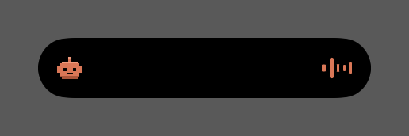
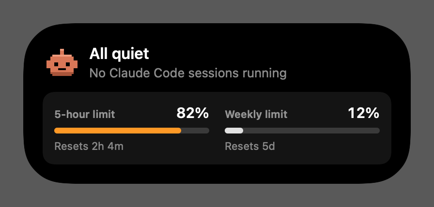
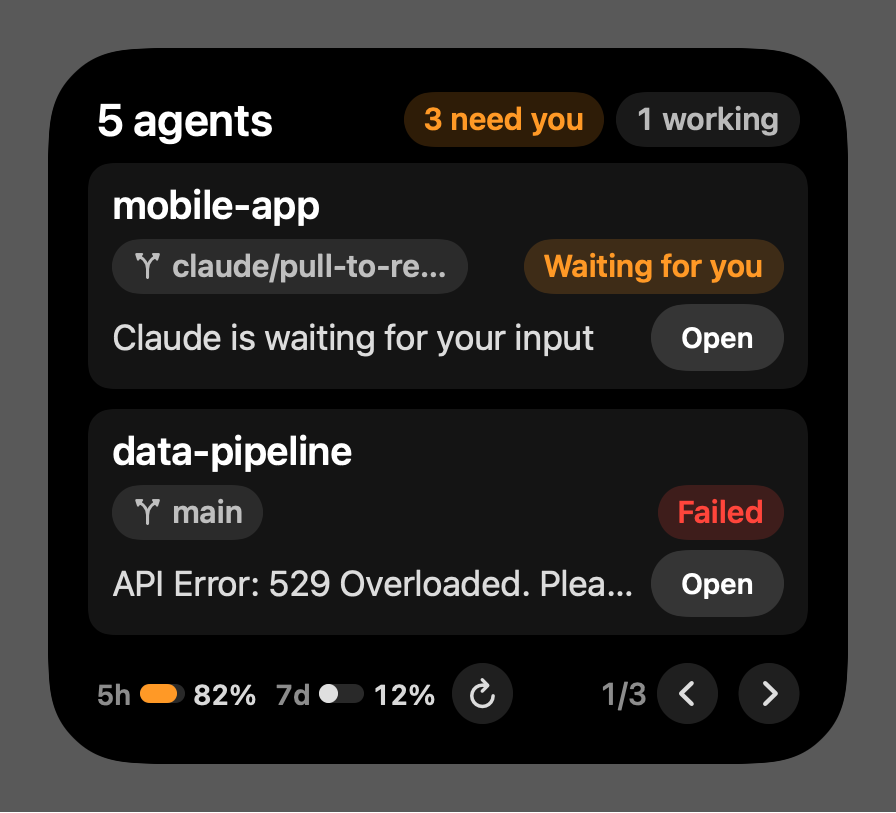

<p align="center">
  
</p>

<h1 align="center">NotchBot</h1>

<p align="center"><strong>Your Claude Code agents, in the notch.</strong><br>
A Dynamic-Island-style status display for <a href="https://claude.com/claude-code">Claude Code</a> on MacBooks with a display cutout.</p>

See every running agent at a glance, get told when something finishes or needs you, approve tool permissions without
switching windows, and keep an eye on your plan limits. All of it lives around the notch.

<p align="center">
  
</p>

> NotchBot is an unofficial, independent community project. It is not made by, affiliated with, or endorsed by
> Anthropic ([details](#trademarks-and-affiliation)).

## Install

You need a Mac on **macOS 27.3 or later** (Live Activities on the Mac; best on a notched MacBook) and **Claude Code**
(the CLI and/or the Claude desktop app's Code tab). Releases are signed and notarized: no Xcode or developer account needed.

**Homebrew**

```bash
brew install --cask jdalessandro/notchbot/notchbot
```

**One-line script** (downloads the latest release, checks its SHA-256, installs to `/Applications`):

```bash
curl -fsSL https://raw.githubusercontent.com/jdalessandro/notchbot/main/scripts/install.sh | bash
```

**DMG:** download `Notchbot-<version>.dmg` (currently `Notchbot-0.1.0.dmg`) from
[Releases](https://github.com/jdalessandro/notchbot/releases/latest), open it and drag **NotchBot** to Applications.

Prefer to build it yourself? See [build from source](CONTRIBUTING.md#build-the-app).

### First run

1. Open NotchBot. A window appears for a moment (starting a Live Activity needs the app in the foreground), then the
   island starts and the app lives in the menu bar.
2. Click **Install hooks** (in the island footer, or *Settings ▸ Integration*).
3. Restart any Claude sessions that were already running.
4. To keep the island visible in fullscreen apps, set System Settings ▸ Control Center ▸ "Automatically hide and show the menu bar" to **Never**. NotchBot asks about this once on first launch and never changes the setting itself.

Hooks are merged into `~/.claude/settings.json` next to any you already have, with a one-time backup at
`settings.json.notchbot.bak`. Just want to look around first? Launch with synthetic agents:
`open -n /Applications/Notchbot.app --args --demo`.

To remove everything: *Settings ▸ Integration ▸ Uninstall*, then delete the app (or `brew uninstall --cask notchbot`).
Uninstall the hooks **first**: removing the app does not remove the hooks it added to `~/.claude/settings.json`.

## What you get

### A compact island that tells you the state

The logo sits left of the cutout and a waveform on the right, one bar per working session (thinner bars for subagents).
The waveform is **coral** while agents work, **orange** when something waits on you, and rests as dots when idle. A
**blue** badge on the logo counts results waiting for your review. Red means negative: failed, destructive, Deny.

<p align="center">
  
  &nbsp;
  
  &nbsp;
  
</p>

### An expanded island that gets out of your way

It opens by itself when something needs you (and on a finished result, if you like), and you can open it any time.

<p align="center">
  
  &nbsp;
  
</p>

- **Approve from the island.** A permission request shows the exact command with **Allow / Deny**. Requests from a
  subagent say so. Approvals are answered only on this card: any other waiting session shows a quiet **Review** that
  brings its request up. A destructive command (`rm -rf`, force-push, `sudo`, ...) keeps green **Allow** / red **Deny** but asks you to tap Allow twice (**Allow**, then **Confirm**).
- **Questions.** When Claude asks you something, the card lists its choices (numbered, with Claude's descriptions) and
  a tap answers Claude, no switching windows. **Other…** jumps to the session to type your own answer, **Skip**
  dismisses it. While a question card is up it has the island to itself; the other sessions come back when you answer
  or skip. Questions with several parts or "choose any" are answered in Claude (**Answer in Claude**).
- **Every session at a glance.** Name, branch, elapsed time, the prompt that started the turn, the current tool,
  context usage, lines changed and token count. Click a session to jump to the app it runs in.
- **A subagent tree.** Each session lists its subagents (what each is doing, tool-call counts, last result). A session
  whose main turn ended but whose subagents still run stays *Working*, and is only marked finished (and notified) when
  the last one stops.
- **Results to review.** When a turn finishes you see Claude's result, marked *Ready to review* until you reply in that
  session or tap **Done**. **Mark all reviewed** is in the island's **⋯** menu.
- **Plan limits.** 5-hour, weekly and per-model weekly limits as bars with reset countdowns (blue, orange from 75%, red
  from 90%), the way Claude Desktop shows them. Flip to token totals (last 5 hours, today, 7 days) with the
  **Limits | Tokens** toggle. Pro and Max hide dollars (you're metered by quota); API billing shows cost.
- **Notifications** with sound and system banners for approval needed, waiting for input, finished and failed.
- **Pages.** More sessions than fit? A pager flips through them.

<p align="center">
  
  &nbsp;
  
</p>

### Make it yours

Open **Settings** from the island's gear icon or **⋯** menu, the menu-bar icon, or ⌘, . Everything applies instantly.

| Tab | What you can change |
|---|---|
| **General** | Island size (5 steps) · review badge on the logo · raise the island when something needs you · how long idle sessions stay |
| **Content** | Show or hide prompt, subagents, context meter and changed lines, usage and quota · usage as limits (%) or tokens · dollar cost |
| **Notifications** | Which events alert you · sound · system banners · details in banners |
| **Integration** | Install / reinstall / uninstall hooks · approve from the island · quota gauges |
| **Advanced** | Raw event log for debugging · reset all settings |

Every option, its default and what it does is in the **[User guide](docs/GUIDE.md)**.

## Privacy

NotchBot runs entirely on your Mac and reads only local Claude Code data (hook events and session transcripts). The only
network request it makes is the same one Claude Code's `/usage` makes, to show your plan limits on Pro and Max (using
Claude Code's own login from your keychain; nothing is sent on API billing). See the
[User guide](docs/GUIDE.md#plan-limits) and [SECURITY.md](SECURITY.md).

## Help

- **Troubleshooting:** [docs/GUIDE.md#troubleshooting](docs/GUIDE.md#troubleshooting)
- **Bugs and ideas:** [open an issue](https://github.com/jdalessandro/notchbot/issues)
- **Changes:** [CHANGELOG.md](CHANGELOG.md)
- **Contributing:** [CONTRIBUTING.md](CONTRIBUTING.md) (build from source, architecture, releasing)

## Roadmap

Launch or resume agents from the island · send a quick follow-up prompt · spend-limit row for API plans · Sparkle
auto-update · launch at login.

## License

[MIT](LICENSE). The license covers this project's code only.

## Trademarks and affiliation

NotchBot is an independent, community project. It is **not affiliated with, endorsed by, or sponsored by Anthropic**.
"Claude" and "Claude Code" are trademarks of Anthropic, PBC, and are used here only to say what this app works with.

This repository does not include Anthropic's logos, the Claude mark, or other Anthropic brand assets, and contributions
must not add them. The island's icons and artwork are original to this project.
